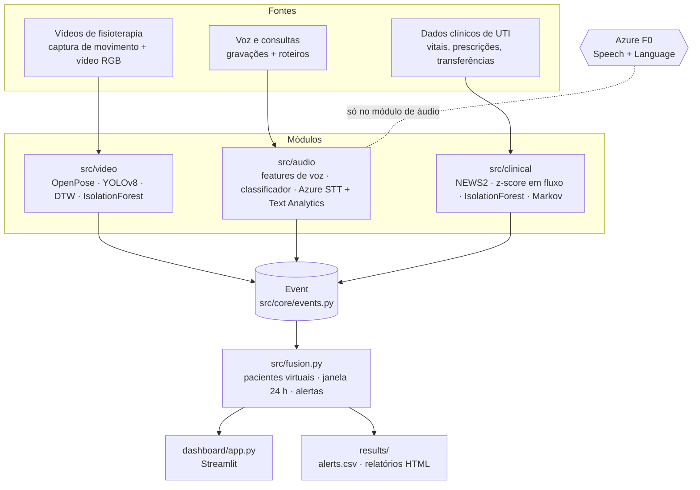
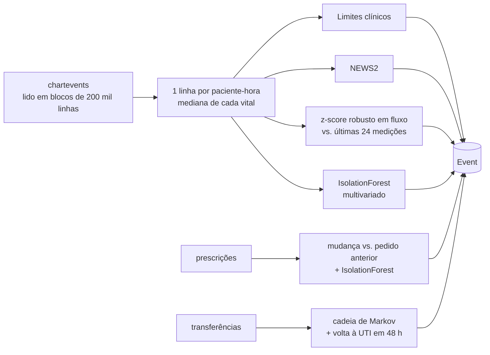
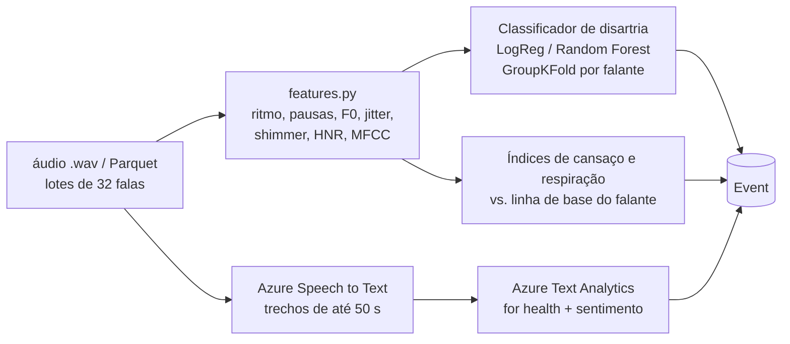
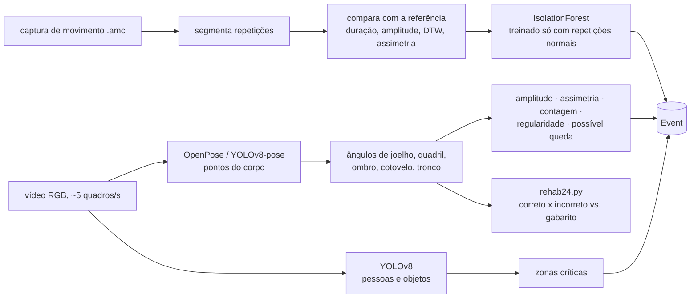
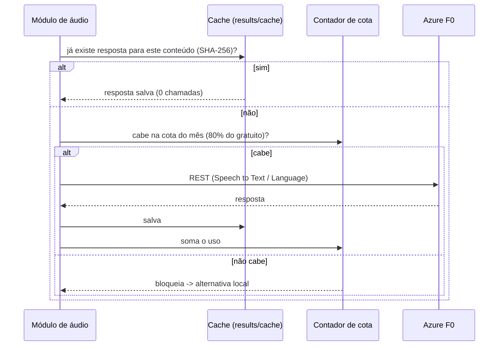

# Arquitetura — Hospital AI

Este documento explica **como o sistema é organizado** e **por que** foi organizado assim.
Para instalar e usar, veja o [README](README.md).

---

## 1. Visão geral

O sistema monitora pacientes a partir de três tipos de dado: **vídeo**, **áudio/texto** e
**dados clínicos**. Cada tipo é analisado por um módulo independente. Todos os módulos falam
a mesma "língua": produzem **eventos** num formato único. Uma etapa de **fusão** combina os
eventos de cada paciente e decide quando gerar um **alerta**.



**Princípios:**

| Princípio | Como aparece no código |
|---|---|
| Módulos independentes | Cada pasta de `src/` só conhece seus dados e o formato `Event` |
| Local primeiro | Tudo roda em CPU; a nuvem entra só onde a entrega exige |
| Custo zero | Cache + contador de cota em `src/core/azure_client.py` |
| Pouca memória | Leitura em pedaços (CSV, Parquet, vídeo quadro a quadro) |
| Explicável | Regras clínicas ao lado de cada modelo; todo evento traz `message` e `evidence` |
| Avaliável | Cada módulo mede a si mesmo (anomalias injetadas, validação por pessoa, gabarito) |

---

## 2. Estrutura de pastas

```
hospital_ai/
├── main.py                  # CLI: inspect | clinical | audio | video | rehab24 | fusion | all | monitor
├── requirements.txt
├── .env.example             # modelo das chaves do Azure (o .env real nunca vai para o Git)
├── src/
│   ├── config.py            # caminhos, limiares, limites do Azure (tudo ajustável num lugar só)
│   ├── inspect_data.py      # checklist dos dados e das chaves
│   ├── fusion.py            # pacientes virtuais + fusão + motor de alertas
│   ├── core/
│   │   ├── events.py        # formato único de evento (Event) + leitura/gravação JSONL
│   │   ├── azure_client.py  # Speech to Text e Language via REST, com cache e cota
│   │   └── report.py        # relatórios HTML (Jinja2 + Matplotlib)
│   ├── clinical/
│   │   ├── loader.py        # leitura em pedaços e padronização em inglês
│   │   ├── vitals.py        # limites, NEWS2, detector em fluxo, IsolationForest, replay
│   │   ├── prescriptions.py # mudanças de dose/via/frequência + IsolationForest
│   │   ├── transfers.py     # cadeia de Markov de setores + regras
│   │   └── pipeline.py
│   ├── audio/
│   │   ├── torgo_loader.py  # leitura do Parquet em lotes
│   │   ├── features.py      # características acústicas (numpy/scipy)
│   │   ├── voice_model.py   # classificador + índices de cansaço/respiração
│   │   ├── text_analysis.py # termos críticos e sentimento (Azure ou local)
│   │   ├── consultations.py # áudio -> Speech to Text -> Text Analytics -> eventos
│   │   └── pipeline.py
│   └── video/
│       ├── amc.py           # leitor de captura de movimento (.amc)
│       ├── motion.py        # repetições vs. referência, DTW, IsolationForest
│       ├── vision.py        # pose (OpenPose/YOLOv8-pose) + YOLOv8 + zonas críticas
│       ├── rehab24.py       # avaliação em vídeo real contra gabarito correto/incorreto
│       └── pipeline.py
├── dashboard/app.py         # painel Streamlit
├── scripts/                 # download de modelos, voz sintética para as consultas
├── tests/make_sample_data.py# dados sintéticos nos formatos reais
├── data/                    # roteiros de consulta (versionados) + vídeos/áudios locais (ignorados)
├── datasets/                # datasets baixados (ignorados pelo Git)
├── models/                  # pesos baixados/treinados (ignorados pelo Git)
└── results/                 # tudo o que o pipeline gera (ignorado pelo Git)
```

---

## 3. O contrato entre os módulos: `Event`

Todos os módulos produzem objetos `Event` (`src/core/events.py`), gravados em
`results/events.jsonl` (um JSON por linha):

| Campo | Exemplo | Significado |
|---|---|---|
| `patient_id` | `mimic:10000032`, `torgo:F01`, `VP001` | Paciente de origem (a fusão troca pelo id virtual) |
| `timestamp` | `2150-01-14T18:00:00` | Quando aconteceu |
| `modality` | `clinical`, `audio`, `text`, `video` | Tipo de dado |
| `source` | `vitals`, `speech_features`, `physio_vision` | Submódulo que gerou |
| `event_type` | `spo2_low`, `dysarthria_risk`, `incorrect_execution` | O que foi detectado |
| `score` | `0.92` | 0 a 1, quanto mais alto mais anômalo |
| `severity` | `high` | Calculado do score: ≥ 0,8 high · ≥ 0,5 medium · ≥ 0,25 low |
| `message` | `spo2 = 88.4` | Explicação curta em inglês para a equipe |
| `evidence` | `{"baseline_median": 97, "robust_z": -9}` | Valores que justificam o evento |

Por que isso importa: um módulo novo (por exemplo, sensores vestíveis) só precisa gerar
`Event` para entrar na fusão, no dashboard e nos alertas, sem mudar nada no resto.

---

## 4. Módulos

### 4.1 Clínico (`src/clinical/`)



- **Detector em fluxo** (`VitalStreamDetector.update`): recebe **um ponto por vez**, compara
  com a mediana e a MAD das últimas medições do mesmo paciente e devolve `(score, tipo, evidência)`.
  É o que permite o modo "tempo real" (`python main.py monitor`).
- **Avaliação:** como a base clínica não tem rótulos de anomalia, `evaluate_with_injection`
  injeta anomalias artificiais e mede precisão e recall.

### 4.2 Áudio e texto (`src/audio/`)



- **Validação por falante:** o classificador é sempre testado em vozes que não viu no treino.
- **Fallback local:** sem chave ou com a cota esgotada, a transcrição usa o roteiro e o texto
  é analisado por um dicionário de termos críticos com regra de negação na mesma frase.

### 4.3 Vídeo (`src/video/`)



- **Exercício unilateral** (ex.: abdução de um braço): detectado automaticamente; a análise usa
  o lado que se move e não acusa assimetria.
- **Contagem de repetições:** pico do ângulo no ombro, vale no cotovelo/quadril; no joelho,
  pela altura do quadril (funciona com a câmera de frente ou de lado).
- **Zonas por vídeo:** `<video>.zones.json` ao lado do vídeo ajusta ou desliga as áreas críticas.

### 4.4 Fusão e alertas (`src/fusion.py`)

1. **Pacientes virtuais:** as bases de dados são de pessoas diferentes; cada `VP001`, `VP002`...
   junta um paciente clínico, um falante, um sujeito de captura de movimento e uma consulta.
   Eventos sem data real (áudio, vídeo) são posicionados no último dia de internação.
2. **Fusão:** para cada evento, olha as últimas 24 h do paciente, pega a maior pontuação de cada
   modalidade e combina:

   `R = 1 − Π (1 − w_m × s_m)` — pesos: clínico 1,0 · texto 0,8 · áudio 0,7 · vídeo 0,6

3. **Alertas:** `medium` (R ≥ 0,5), `high` (R ≥ 0,8), `critical` (R ≥ 0,9 com 2+ modalidades
   ≥ 0,5). Não repete alerta do mesmo paciente antes de 6 h, a menos que o nível piore.

---

## 5. Nuvem: Azure no plano gratuito



| Serviço | Uso | Limite gratuito | Limite do projeto |
|---|---|---|---|
| Speech to Text | Transcrição de consultas e de amostra de fala | 5 h/mês | 4 h |
| Language (sentimento + health) | Termos críticos, negação, sentimento | 5 000 registros/mês | 4 000 |

As chaves ficam no `.env` (lido por `python-dotenv`), que está no `.gitignore`.
A detecção de anomalias é local porque o Azure AI Anomaly Detector foi desativado em 01/10/2026.

---

## 6. Memória e desempenho

| Ponto | Estratégia |
|---|---|
| Tabela de sinais vitais | `pandas.read_csv(chunksize=200_000)` filtrando só os itens de vitais |
| Base de fala (Parquet) | `pyarrow.ParquetFile.iter_batches(batch_size=32)` |
| Vídeo | Um quadro por vez, ~5 quadros/s, redimensionado para 640 px; quadros pulados com `grab()` |
| DTW | Curvas reduzidas a ~150 pontos e banda de Sakoe-Chiba |
| Pose em lote | Ângulos em cache (`results/rehab24_angles/`) |

Pico típico abaixo de 3 GB de RAM; nenhuma etapa exige GPU.

---

## 7. Como estender

| Quero... | Onde mexer |
|---|---|
| Mudar limiares clínicos, pesos da fusão, janela, cooldown | `src/config.py` |
| Adicionar um exercício de fisioterapia | `PHYSIO_EXERCISES` e `aliases` em `src/video/vision.py` |
| Adicionar termos críticos | `CRITICAL_TERMS` em `src/audio/text_analysis.py` |
| Adicionar uma nova modalidade | Gerar `Event` e chamar `save_events`; a fusão já a considera |
| Mudar as zonas críticas | `ZONES` em `src/video/vision.py` ou `<video>.zones.json` |
