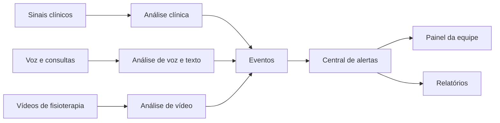
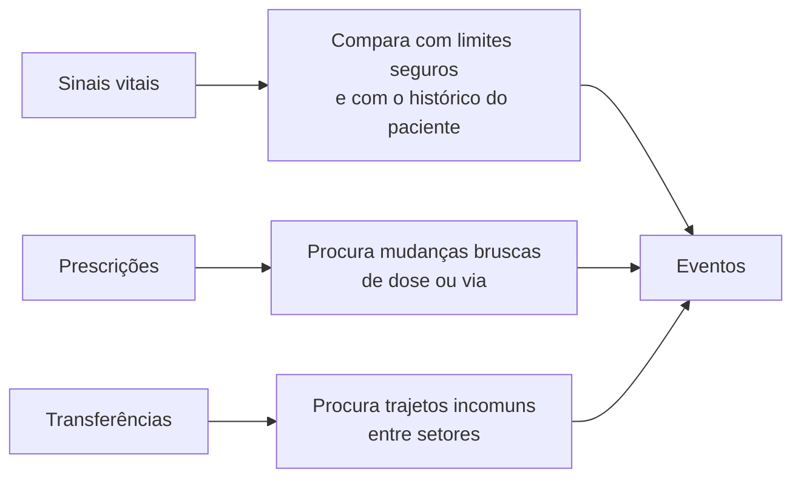
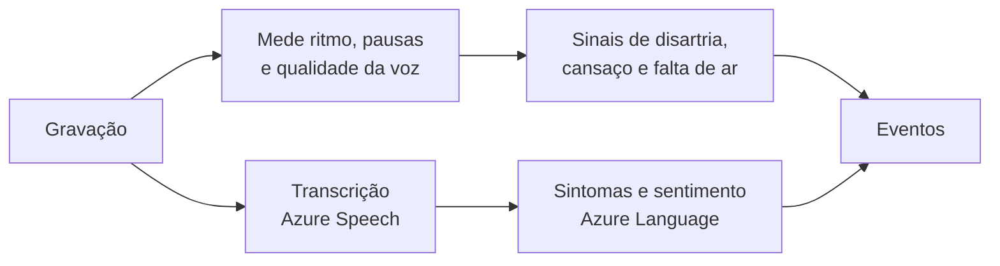
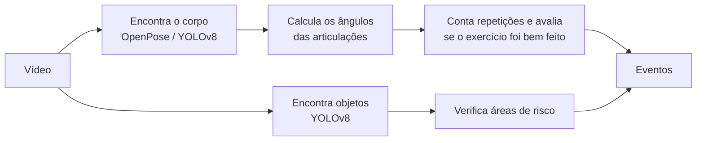
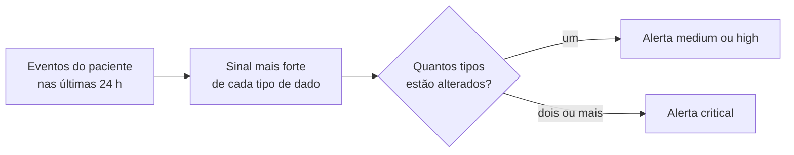
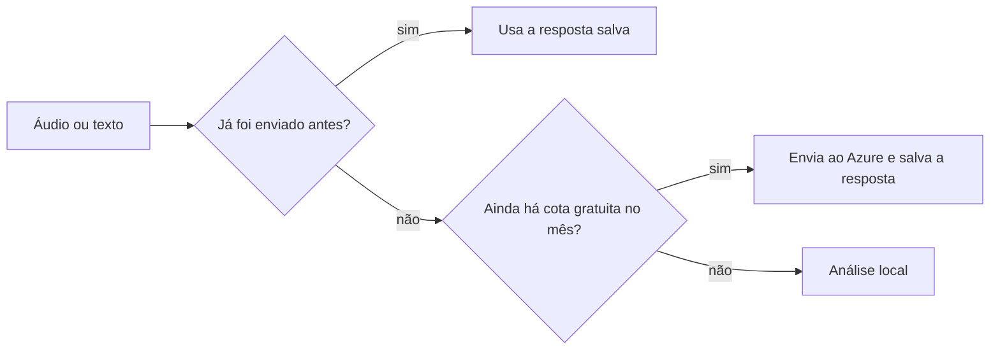

# Arquitetura — Hospital AI

Como o sistema é organizado, em linguagem simples. Para instalar e usar, veja o [README](README.md);
para o significado dos termos técnicos (NEWS2, Isolation Forest, DTW...), veja o [Glossário](README.md#15-glossário).

---

## 1. A ideia em uma frase

Cada tipo de dado do paciente é analisado por um **módulo próprio**; todos os módulos registram o
que encontram como **eventos** no mesmo formato; uma **central de alertas** junta os eventos de cada
paciente e decide quando avisar a equipe.

---

## 2. De onde vêm os dados

O sistema foi pensado para os dados que um hospital já produz. Cada módulo lê um formato definido;
qualquer fonte nesse formato pode ser conectada.

| Tipo de dado | No hospital | Formato lido pelo sistema | Base de exemplo usada na validação |
|---|---|---|---|
| Sinais clínicos | Prontuário eletrônico: sinais vitais, prescrições, transferências | Tabelas CSV | Base clínica de UTI desidentificada |
| Voz | Gravações de voz do paciente | Áudio WAV com o texto falado | Base de fala com e sem disartria |
| Consultas | Áudio das consultas | WAV + roteiro | 12 consultas roteirizadas |
| Fisioterapia | Câmeras na sala de fisioterapia ou sensores de movimento | Vídeo (MP4, AVI...) ou captura de movimento (`.amc`) | Base de vídeos de exercícios com gabarito de fisioterapeuta e base de captura de movimento |

As bases de exemplo servem para demonstrar e medir o funcionamento; os formatos e as referências
completas estão no [README](README.md) (seções 4 e 16).

---

## 3. Os módulos

### Análise clínica

- **Sinais vitais:** frequência cardíaca, pressão, saturação, respiração e temperatura. Gera alerta
  quando um valor sai da faixa segura, quando muda de repente em relação ao próprio paciente ou
  quando a combinação de sinais é rara. Usa também o escore de alerta precoce NEWS2.
- **Prescrições:** dose que dobra ou cai pela metade, troca de via (ex.: oral para venosa),
  pedidos repetidos do mesmo remédio.
- **Transferências:** caminhos raros entre setores e volta à UTI em menos de 48 h.

### Análise de voz e texto

- **Voz:** compara cada gravação com a voz habitual da pessoa e com um modelo treinado para
  reconhecer disartria.
- **Texto:** transforma a consulta em texto, encontra sintomas e medicamentos (separando o que o
  paciente negou, como "no fever") e mede o sentimento.

### Análise de vídeo

- **Movimento:** amplitude, simetria entre os lados, ritmo, inclinação do tronco e possível queda.
- **Áreas de risco:** objeto no chão onde o paciente pode tropeçar, paciente fora da área do exercício.
- **Relatórios:** cada sessão gera um HTML com os desvios, gráficos e quadros do vídeo.

---

## 4. O evento: a "língua comum" dos módulos

Tudo o que um módulo encontra vira um evento com os mesmos campos:

| Campo | Exemplo |
|---|---|
| Paciente | `VP001` |
| Quando | `2150-01-14 18:00` |
| Tipo de dado | `clinical`, `audio`, `text` ou `video` |
| O que foi detectado | `spo2_low` (saturação baixa) |
| Pontuação (0 a 1) | `0.92` |
| Gravidade | `high` |
| Explicação | `spo2 = 88.4` |

Por isso um novo tipo de dado (por exemplo, um sensor vestível) entra no sistema só gerando eventos,
sem mexer no resto.

---

## 5. Central de alertas

- Quanto mais tipos de dado alterados ao mesmo tempo, maior o risco. Os dados clínicos pesam mais,
  por serem a medida mais direta do estado do paciente.
- Só sinais relevantes entram (pontuação 0,5 ou mais), e um alerta *high* precisa de confirmação:
  dois tipos de sinal diferentes, escore NEWS2 elevado ou mais de um tipo de dado alterado.
- O mesmo alerta não se repete antes de 12 h, a menos que a situação piore.
- Com as bases de exemplo, que são de pessoas diferentes, cada "paciente virtual" (`VP001`...)
  combina registros de bases distintas para demonstrar a fusão. Com dados reais de um mesmo
  paciente, a fusão usa o id do próprio paciente.
- Cada alerta traz a ação sugerida: **critical** → avaliação imediata; **high** → avaliação à beira
  do leito em até 1 h; **medium** → revisão na próxima visita.

---

## 6. Uso do Azure

- **Azure AI Speech:** transcreve as consultas.
- **Azure AI Language:** encontra sintomas, medicamentos e sentimento no texto.
- Cada conteúdo é enviado uma única vez, e o sistema para em 80% da cota gratuita do mês. As chaves
  ficam num arquivo `.env` local, que nunca vai para o repositório.

---

## 7. Onde fica cada parte no código

| Pasta / arquivo | O que tem |
|---|---|
| `main.py` | Comandos do sistema (`clinical`, `audio`, `video`, `fusion`, `all`...) |
| `src/config.py` | Todos os ajustes num lugar só: limites clínicos, pesos, janelas |
| `src/clinical/` | Análise clínica |
| `src/audio/` | Análise de voz e texto |
| `src/video/` | Análise de vídeo e relatórios de fisioterapia |
| `src/core/events.py` | O formato do evento |
| `src/core/azure_client.py` | Conexão com o Azure, cache e controle de cota |
| `src/fusion.py` | Central de alertas |
| `dashboard/app.py` | Painel da equipe |
| `tests/make_sample_data.py` | Gera dados sintéticos para testar sem baixar nada |
| `example_data/` | Amostras reais pequenas de cada tipo de dado, para rodar o projeto direto do repositório |
| `scripts/build_example_data.py` | Gera `example_data/` a partir das bases completas |

---

## 8. Desempenho

- Roda em CPU, sem placa de vídeo.
- Usa menos de 3 GB de memória: tabelas são lidas em blocos, áudio em lotes pequenos e vídeo um
  quadro por vez (cerca de 5 quadros por segundo).
- Resultados já calculados (respostas do Azure, ângulos dos vídeos) ficam salvos e não são refeitos.
